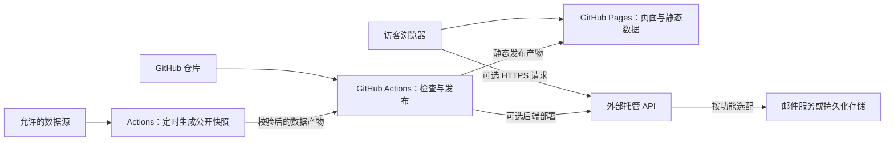

# Yang Luo 个人网站设计方案

版本：1.1 · 日期：2026-10-27 · 状态：待实施

本文记录改版目标、内容结构、交互方案与实施顺序；具体视觉参数和组件规则以根目录 [DESIGN.md](../DESIGN.md) 为准。本文中的目标效果与验收指标不代表网站已经实现或通过测试。

## 1. 定位与目标

将网站建设为**可交互的机器人研究作品集**。通过真实机器人、控制系统界面、实验过程和学术成果，帮助研究同行、工程开发者及潜在合作者理解 Yang Luo（罗阳）的工作。

核心叙事：**从控制软件到机器人实验，让研究成果可以被看见、理解和探索。**

访客应能完成三件事：

1. 在首屏了解姓名、研究身份与研究重点。
2. 从代表项目进入实验演示、技术说明或开源代码。
3. 找到论文、个人经历与联系渠道。

延续 HTML/CSS/JavaScript、Bootstrap、jQuery 与 GitHub Pages。采用 Anime.js 增强交互，首轮保持静态前端与直接预览流程；当功能确实需要私密凭据、提交处理或持久化时，可引入独立后端，并使用 GitHub Actions 完成测试与部署。后端依赖和构建流程限定在服务目录，不强制迁移前端框架。

## 2. 当前网站与改版重点

依据当前源码，以及 1440、768、390px 宽度的首页预览：

| 当前情况 | 对访客的影响 | 改版动作 |
| --- | --- | --- |
| 首屏以姓名、打字介绍、导航为主，桌面右侧留白明显 | 不能立即看到机器人研究成果 | 引入真实机器人画面与明确的项目入口 |
| 内容通过 `.header-top`、`.section-show` 切换显示 | 项目需要主动寻找，手机首屏信息较少 | 改为连续滚动首页，保留既有锚点 |
| 项目以相近权重的图片网格呈现 | 代表成果不突出 | 增加三个精选项目，其余保留为完整项目索引 |
| 字体、字号、内联样式和强调色较多 | 页面之间一致性不足 | 建立统一设计变量、组件与状态规则 |
| 论文主要为连续段落 | 年份、成果类型与入口不易扫读 | 按年份倒序排列，明确标题、作者、发表信息和链接 |
| 交互分布在多个插件及内联脚本中 | 新增动效容易重复或冲突 | 明确导航、布局和动画的职责边界 |

首页预览不等于所有页面的交互验收。自动检查器针对连续滚动页面产生的“隐藏内容”提示，不能直接认定为现有分区切换机制的缺陷。

## 3. 信息架构

### 3.1 首页阅读顺序

| 顺序 | 区域 | 内容与证明材料 | 主要动作 |
| --- | --- | --- | --- |
| 1 | 首屏 | 姓名、固定研究身份、简短定位、TALON 或 ROCOS 实验画面 | Explore my work → `#project` |
| 2 | 精选项目 | ROCOS、TALON、柔顺伺服驱动的大图、问题、贡献与演示入口 | 阅读项目详情 |
| 3 | 研究方向与完整项目索引 | 运动控制、轨迹规划、人机交互等方向，对应真实项目 | System / Control / HMI 筛选 |
| 4 | ROCOS 系统探索 | 以现有架构图为依据解释模块关系 | 选择模块、查看界面或演示 |
| 5 | Publications | 论文、会议与专利，完整保留已有条目 | 阅读原文、复制已核实引用 |
| 6 | About | 个人简介、教育、经历、技能与合作者 | 了解研究背景 |
| 7 | Contact | 邮箱、GitHub、机构信息与现有联系渠道 | 发起邮件或访问 GitHub |

首屏导航采用 Projects、Publications、About、Contact；姓名链接返回 `#header`。保留 `#project`、`#publication`、`#about`、`#contacts` 以及现有项目详情 URL。

### 3.2 首屏草案

桌面使用左侧介绍、右侧真实机器人媒体的双栏构图；媒体约占内容宽度 55%。手机按姓名、定位、行动按钮、媒体排列，控制空白，使首屏附近即可看到研究内容。

> Yang Luo · 罗阳
>
> Robotics Researcher
>
> I build robot control systems for precise motion, compliant interaction, and real-world experiments.

主按钮为 **Explore my work**，次要入口为 GitHub 文本链接。研究身份始终可见；取消循环打字对核心介绍的依赖。上述英文定位为编辑草案，发布前核实其与实际研究范围一致。

### 3.3 项目详情页

统一为“项目名称 → 一句话摘要 → 实验画面 → 问题与方法 → 本人贡献 → 结果与限制 → 代码/论文/相关项目”。保留完整既有内容，先调整层级，再逐步补充缺失说明。

每个项目说明区分个人贡献、合作团队与系统能力。所有性能参数必须来自项目材料或可引用的实验记录；缺少证据时不写指标。首页的精选介绍使用交错的大图与文字，完整索引使用紧凑的项目条目，避免所有区域重复同一种卡片布局。

## 4. 视觉方向与素材

采用精密、克制、具有实验现场感的视觉语言：冷白阅读区、石墨黑媒体区、工程蓝重点动作。科技感由机器人机构、实际控制界面和架构关系体现。

素材优先使用仓库现有文件，以下均为待筛选候选：

| 主题 | 已有素材 | 建议用途 |
| --- | --- | --- |
| TALON | `projects/cobot/talon1.png`、`intro.jpg`、`complicant.mp4`、`dual_arm.gif` | 首屏或精选项目 |
| ROCOS | `projects/rocos/rocos-viz.png`、`relationship.png`、`arch.png` | 控制界面与系统探索 |
| ROCOS 实验 | `projects/rocos/6dof.mp4`、`7dof.mp4`、`ui.mp4` | 按需播放的项目演示 |
| 柔顺伺服 | `projects/servo_driver/drivers.png`、`position_control.gif`、`complicant_control.gif` | 驱动器、控制过程展示 |
| 其他研究 | 各项目目录内的 `intro.jpg` 与实验媒体 | 完整项目索引与详情页 |

制作首屏短片前检查片段内容、画质和体积；保留原始素材，单独输出压缩衍生文件及封面。已有文件名即使存在拼写问题也不直接改名，避免破坏引用。

## 5. 动效与特色交互

### 5.1 Anime.js 动效分配

采用 Anime.js v4 的 `animate`、`createTimeline`、`stagger`，需要时使用 `onScroll` 和 SVG 工具；下载时固定具体版本，并按照该版本文档验证 API。

| 场景 | 设计 | 时长建议 | 播放策略 |
| --- | --- | --- | --- |
| 首屏入场 | 简介、按钮、媒体轻微上移并显现 | 450–700ms | 每次页面加载最多一次，不延迟核心文字 |
| 段落进入视口 | 标题、摘要和图像分组显现 | 350–500ms，间隔约 70ms | 首次进入时播放 |
| 项目筛选 | 状态立即改变，结果平滑排列 | 200–300ms | 最新一次输入优先，取消过期动画 |
| 控件反馈 | 按下、聚焦、悬停反馈 | 120–180ms | 键盘与触屏同样可用 |
| 年份筛选 | 新结果短暂淡入 | 150–250ms | 保留焦点和阅读位置 |
| ROCOS 架构 | 选中模块和连接关系强调 | 400–700ms | 由用户触发，可立即切换 |

普通界面运动只调整 `transform`、`opacity`。SVG 路径绘制仅用于表达真实模块关系。页面同一视口避免多个循环动画同时争夺注意力。

### 5.2 ROCOS 系统探索器

使用现有 `relationship.png`、项目说明与界面截图确认模块职责和连接方向，再制作可交互图示。

- **ROCOS-Viz**：展示可视化、操作与交互界面。
- **ROCOS-APP**：展示机器人运动控制与运动学相关能力。
- **ROCOS-ECM**：展示 EtherCAT 通信和设备连接职责。
- 用户选择模块后，显示对应说明、截图及详情链接，并强调相关连接。
- 图示注明“架构示意”；演示视频与模块说明独立播放，不暗示实时连接或与图示同步采集。
- 手机使用纵向模块选择；无脚本时展示完整静态架构图和三个模块说明。

## 6. 技术实施边界

### 6.1 前端职责与迁移

| 文件或目录 | 计划职责 |
| --- | --- |
| `index.html` | 内容重排、连续滚动结构、语义化导航和媒体 |
| `assets/css/style.css` | 统一设计变量、组件、响应式和减少动态效果规则 |
| `assets/js/main.js` | 导航、筛选、插件初始化与已有地图逻辑 |
| `assets/js/motion.js`（新增） | Anime.js 动画生命周期与媒体播放策略 |
| `assets/vendor/animejs/`（新增） | 固定版本的浏览器构建、许可证和版本说明 |
| `projects/*/index.html` | 逐步迁移项目详情模板，保留 URL 和素材引用 |

迁移时同时检查首页与项目详情页共用的 CSS/JS。连续滚动样式必须限定在首页作用域，避免修改全局 `section` 选择器破坏其他页面。

Isotope 管理项目外层排列；Anime.js 只控制内部预览元素，不同时修改同一元素的 `transform`。删除 Typed.js 或其他插件前，检查所有页面引用及初始化代码。桌面可保留 Venobox 快速预览，但所有项目必须有可直接访问的详情链接，手机优先直接访问。

保留现有 `CNAME` 与前端域名。后续确有需要时可新增 Actions 工作流及独立 API 域名；此次仅完善设计文档，不创建云资源、不配置凭据、不执行部署。

### 6.2 后端引入条件

采用“静态优先、按需服务化”的策略。需要自动更新不一定需要在线后端：适合缓存的公开信息，可以由 Actions 定期生成静态数据。

| 需求 | 首选方案 | 是否需要在线后端 |
| --- | --- | --- |
| Anime.js 动画、项目分类、论文筛选、ROCOS 架构探索 | 浏览器本地逻辑与静态数据 | 否 |
| GitHub 项目公开信息、已核实的论文元数据更新 | Actions 定时拉取、校验并生成 JSON 快照 | 否 |
| 联系表单、需要保密密钥的第三方接口 | 独立 HTTPS API，由 Actions 部署 | 是，启用对应功能时才建设 |
| 留言管理或其他持久化写入 | API 加托管存储，并定义访问权限与保留期限 | 是，另行明确产品需求 |
| 实验视频与历史结果回放 | 静态媒体，体积或流量增加时评估对象存储 | 通常不需要计算服务 |

当前两阶段改版的核心体验不依赖在线后端。首个后端候选功能为联系表单；公开项目数据自动更新可先采用静态快照，论文新增或作者归属变化仍需内容核实。

### 6.3 部署架构

GitHub Pages 是静态托管服务；GitHub Actions 用于检查、构建和发布。需要在线 API 时，由 Actions 将服务部署到独立运行平台，不将工作流中的临时进程作为常驻服务器。[GitHub Pages 官方说明](https://docs.github.com/en/pages/getting-started-with-github-pages/what-is-github-pages)

轻量 API 优先评估 Cloudflare Workers 这类托管函数，减少个人网站的运维负担；其官方文档提供通过 GitHub Actions 部署的流程。只有明确需要特定 Python 依赖、原生库或长时间任务时，才评估独立容器服务。[Workers 部署参考](https://developers.cloudflare.com/workers/ci-cd/external-cicd/github-actions/)

平台选择需结合已有账户、访客访问地区、实际延迟、运行时限制、预算与维护成本；当前未选定或开通服务。数据库、队列与对象存储按功能需要单独启用，不作为基础改版的默认依赖。

前端访问独立 HTTPS API 基地址，可使用平台域名或将来配置的 `api.yluo.name`。GitHub Pages 不直接提供 `/api` 反向代理，因此必须显式配置完整 API 地址；服务端按实际前端域名设置跨域允许列表。API 地址可公开，访问令牌和邮件凭据不能进入页面或静态配置。

### 6.4 GitHub Actions 工作流设计

以下均为计划文件，实际实施时先核实仓库现有 Pages 发布设置、默认分支和工作流，避免重复部署：

| 计划位置 | 职责与触发条件 |
| --- | --- |
| `.github/workflows/site-check.yml` | PR 检查前端语法、链接、静态数据格式；仅验证，不部署 |
| `.github/workflows/deploy-pages.yml` | 受控发布分支更新或手动发布时，校验并发布静态产物 |
| `.github/workflows/refresh-public-data.yml` | 按日或按周更新公开数据，也支持 `workflow_dispatch` 手动重试 |
| `.github/workflows/deploy-api.yml` | 启用后端后，对服务变更执行测试、部署、健康检查及版本记录 |
| `services/api/` | 后端代码、接口契约、测试、独立依赖锁文件和平台配置 |
| `scripts/`、`assets/data/` | 数据生成脚本及可公开快照；存放位置以实施时的维护方式为准 |

**静态发布流程：** 校验源码和数据 → 组装前端发布目录 → 检查链接与资源 → 上传 Pages artifact → 发布。后端源码、测试输出、环境文件不进入 Pages 发布产物，`CNAME` 和已有资源路径保持完整。

**数据更新流程：** 获取允许的公开数据 → 校验字段、来源、更新时间和规模 → 生成候选快照 → 发布成功才替换线上数据。自动更新仓库统计与论文内容审核分开处理；失败时保留上一版并显示真实更新时间。调度可能延迟，不能把它当作实时数据保证。[Actions schedule 说明](https://docs.github.com/en/actions/reference/workflows-and-actions/events-that-trigger-workflows#schedule)

选择“快照入库”或“快照作为构建产物”其中一种作为唯一维护路径。若采用构建产物，定时更新与正常前端发布须使用同一份有效快照，避免下一次代码部署丢失数据；若采用入库方式，在同一受控流程内显式编排发布，不依赖自动提交一定触发后续工作流。

**后端发布流程：** 锁定依赖安装 → 接口测试 → 构建不可变版本 → 部署 → 检查 `/health` 与关键接口 → 记录提交 SHA、版本、目标环境和结果。部署失败不发布依赖它的新前端功能；保留上一可用版本用于回滚。部署任务按环境串行，避免并发覆盖；前后端接口采用向后兼容变更。

部署凭据使用最小权限：平台支持时优先 OIDC 短期身份，并限制仓库、分支或环境；否则使用部署专用、限定范围的 Actions Secrets。OIDC 的 `id-token: write` 仅授予需要交换身份的任务，不等于直接获得云资源写权限。[GitHub OIDC 文档](https://docs.github.com/en/actions/how-tos/secure-your-work/security-harden-deployments/oidc-in-cloud-providers)

Workers 的参考方案使用 `CLOUDFLARE_API_TOKEN` 等 CI 配置，具体按所选平台验证。第三方 Action 固定经审查的提交版本，PR 检查不接触生产凭据；邮件与存储运行时密钥放在托管平台的密钥配置中。

### 6.5 可选 API 与界面状态

联系表单仅在真实服务上线后启用，邮箱链接始终保留为替代入口。首版仅收集回复邮箱、主题和留言，姓名可选，不增加附件上传。

| 接口候选 | 行为与界面约定 |
| --- | --- |
| `GET /health` | 返回最小健康状态；不暴露内部凭据或详细配置 |
| `POST /v1/contact` | 服务端校验长度与字段、限制请求速率、处理防滥用验证与重复提交 |
| `assets/data/projects.json` | 公开数据静态快照，包含来源与更新时间；不包含私人信息 |

提交状态必须覆盖：可编辑、提交中、已接收、字段错误、请求过多、超时或服务不可用。HTTP 202 只表示已接收或排队，不显示“邮件已送达”；成功文案与实际接口契约一致。失败保留当前输入，提供重试和邮件入口；不会自动反复提交。重试使用服务端幂等策略避免重复发送。

跨域配置不替代服务端校验与防滥用措施。留言不写入公开仓库、公开 Issue、Actions 日志或公开构建产物。若启用持久化，需明确访问者、保留期限、删除与备份方式。健康检查、错误日志和用量告警由托管平台承担，日志避免记录完整留言和邮箱。

后端不可用时，论文、项目、媒体与导航仍正常工作。数据接口设置超时，公开快照加载失败时回退页面已有内容；API 地址未配置时不展示提交表单。

## 7. 实施阶段与交付物

### 第一阶段：内容与视觉基础

- 固定首屏文案与候选素材，统一颜色、字体、间距及按钮。
- 完成连续滚动首页、三个精选项目和完整项目索引。
- 接入 Anime.js，完成入场、进入视口、按钮反馈及减少动态效果分支。
- 交付桌面、平板、手机截图，以及锚点、筛选、媒体和详情页回归记录。

### 第二阶段：研究探索与成果整理

- 完成 ROCOS 架构交互及静态回退。
- 整理论文年份、成果类型与已核实的原文链接；实现筛选和空结果状态。
- 统一项目详情页，补齐可核实的贡献、结果和相关资料。
- 交付性能与可访问性检查记录、更新后的维护说明。

### 可选第三阶段：自动化数据与后端能力

- 有公开信息更新需求时，先完成 Actions 数据快照流程、来源标注、失败保留与手动重试。
- 确有提交或私密接口需求时，再选择托管平台、定义 API 契约、实现联系表单和必要存储。
- 配置独立服务部署、健康检查、版本回滚与用量告警；验证不同访问地区的可用性。
- 交付部署说明、环境变量名称清单、接口与故障回退测试记录；实际密钥不进入文档。

第一阶段已形成待审阅的本地实现，截图与验证记录见 [第一阶段审阅说明](phase-one-review.md)。第二阶段及可选第三阶段仍为待办；第三阶段不作为前两个阶段上线的前置条件。

## 8. 验收与待核实内容

依据 [设计规范验收清单](../DESIGN.md#11-验收清单) 检查 320、390、768、1024、1440px 布局，另检查 991/992px 导航断点。必须覆盖键盘操作、直接锚点访问、浏览器前进后退、无 JavaScript、减少动态效果及媒体加载失败。

开发记录包含检查环境、结果、截图和未解决问题。性能预算属于目标值，必须实际测量后报告；不将视觉检查器的风格评分等同于可访问性合规认证。

启用自动化或后端时追加检查：数据生成失败保留旧快照、普通部署不覆盖有效快照、API 超时和限流提示、重复提交幂等、跨域允许列表、服务不可用时的邮件回退，以及从失败版本回滚到上一版本。对提交接口和数据校验增加实际自动化测试，不要求纯文档修改启动应用测试。

实施前按现有材料核实以下事项；未核实内容保持原有事实或省略新增表述，不阻塞基础布局：

- 首屏实验片段选择、可公开范围及是否含需注明的合作贡献。
- 三个精选项目顺序、个人贡献与性能结果。
- 当前职务、机构名称、论文原文和引用信息。
- 以英文为主、中文姓名辅助；完整中英切换不在首轮范围内。
- 是否确实需要联系表单或数据自动更新；若需要，明确托管账户、预算、域名权限、维护责任人与数据保留方式。基础前端改版可先完成。

## 9. 参考资料

- [awesome-design-md](https://github.com/voltagent/awesome-design-md)：借鉴设计规范的组织方式，具体取舍见 [DESIGN.md](../DESIGN.md#12-参考与维护)。
- [Anime.js 安装](https://animejs.com/documentation/getting-started/installation/)：本地浏览器构建接入。
- [Anime.js onScroll](https://animejs.com/documentation/events/onscroll/)：进入视口及滚动关联动画。
- [Anime.js SVG](https://animejs.com/documentation/svg/)：架构连接的路径绘制。
- [GitHub Pages](https://docs.github.com/en/pages/getting-started-with-github-pages/what-is-github-pages)：静态托管职责。
- [GitHub Actions OIDC](https://docs.github.com/en/actions/how-tos/secure-your-work/security-harden-deployments/oidc-in-cloud-providers)：外部平台部署身份。
- [Workers 与 GitHub Actions](https://developers.cloudflare.com/workers/ci-cd/external-cicd/github-actions/)：可选轻量 API 的部署参考。
- [Actions schedule](https://docs.github.com/en/actions/reference/workflows-and-actions/events-that-trigger-workflows#schedule)：定时数据任务的触发与限制。以上资料查阅于 2026-10-27。
